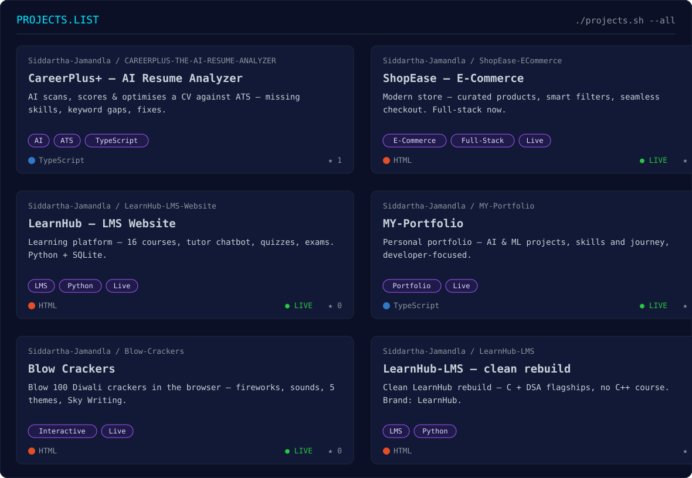

<!-- ========================================================= -->
<!--  GitHub Profile README — Siddartha Jamandla               -->
<!--  Recreated 9 Nov 2026, as in the Arif Hasan reel           -->
<!--  (instagram.com/reel/DbSQZG0vsqn, @arifhaxn) — layout     -->
<!--  only: terminal hero, VISUAL.MAP + SYSTEM.INFO, stats,    -->
<!--  snake, PROJECTS.LIST, social badges. All facts are       -->
<!--  Siddartha's own verified data; Arif's name, photo,       -->
<!--  projects and stats were NOT copied.                       -->
<!--  Stats use the working widget hosts (checked 9 Nov 2026): -->
<!--  github-readme-stats-sigma-rosy-28.vercel.app (the main    -->
<!--  vercel.app instance is 503) and streak-stats.demolab.com. -->
<!-- ========================================================= -->

<!-- HERO -->

<picture>
  <source media="(prefers-color-scheme: dark)" srcset="./hero-dark.svg">
  <source media="(prefers-color-scheme: light)" srcset="./hero-light.svg">
  
</picture>

**[▶ Open the full interactive version →](https://muse.ai/s/siddartha-jamandla-github-profile-xnxv6xi57y2xhxb1/yhVoBCzr6hMN_IkKmahv1sIx3hSmBrkqqb_ilL-4au8)** — the portrait morphs live into SIDDARTHA, `</>`, an orbit ring and AI·ML, just like the video.

---

### 🏆 GitHub Achievements

- ⚡ Quickdraw — Issue closed within 5 minutes ✅ unlocked
- 🎯 YOLO — Pull request merged with no review ✅ unlocked
- 🦈 Pull Shark — 16 merged pull requests in the github_badges repo, bronze threshold met, badge awaiting GitHub processing ⏳
- Link: https://github.com/Siddartha-Jamandla/github_badges
<!-- GITHUB STATS -->

<!-- CONTRIBUTION SNAKE -->

<!-- PROJECTS -->

<!-- ACHIEVEMENTS -->

🏆 <b>GitHub Achievements</b> — Quickdraw ✅ · YOLO ✅ · Pull Shark ⏳ (16 merged PRs done — the badge appears once GitHub processes it)

<!-- SOCIAL BADGES -->

